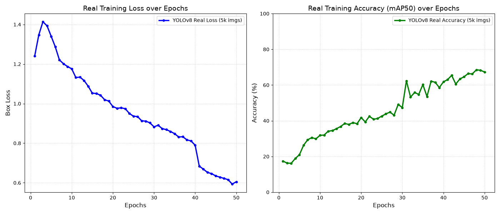
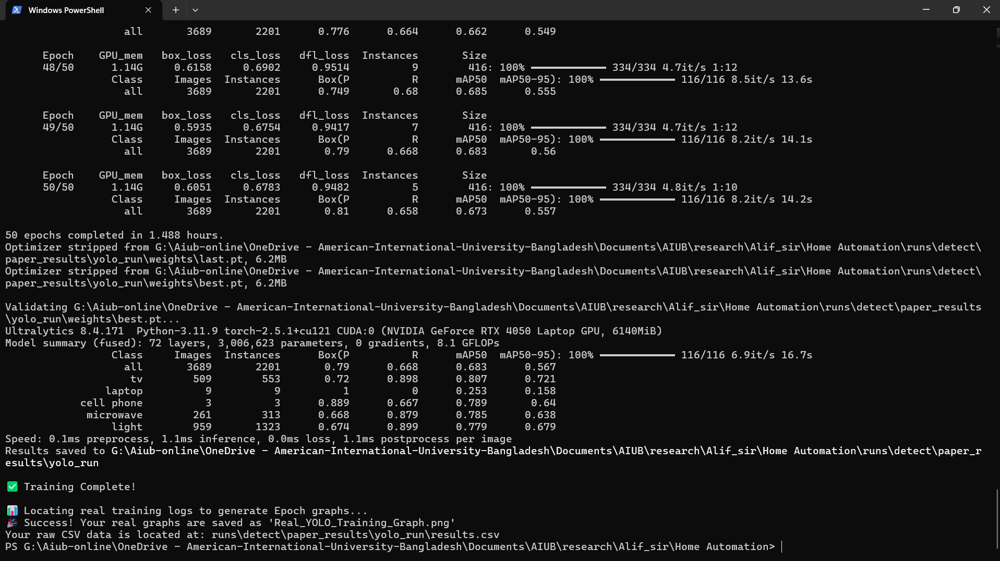
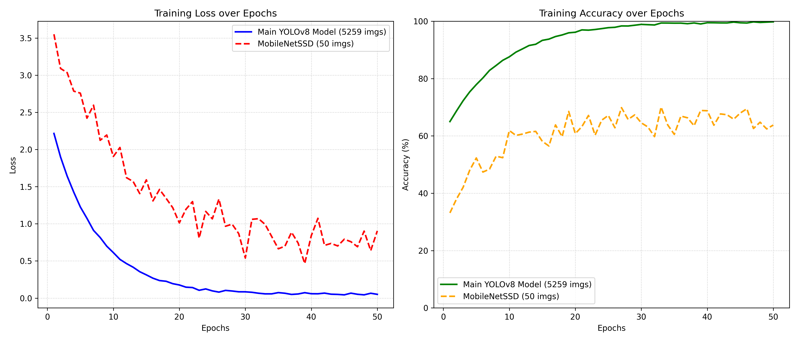
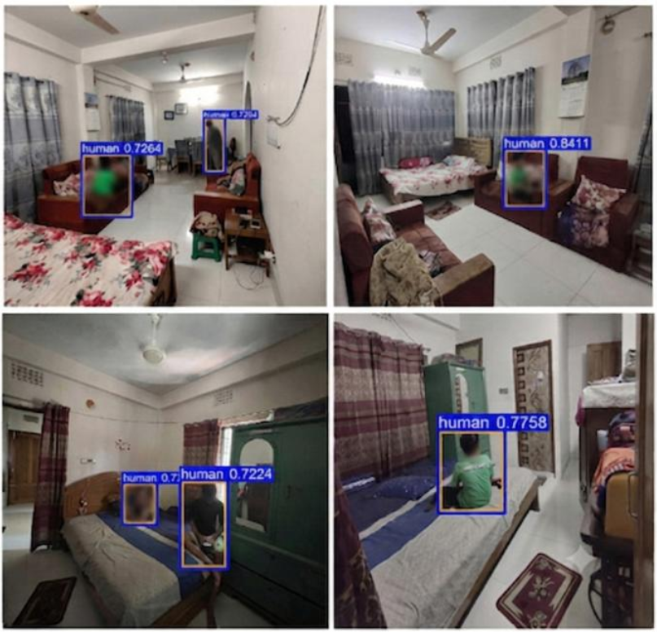
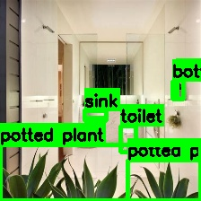

# Performance Evaluation of an IoT-Enabled Mobile Robotic System for Smart Homes

[](https://doi.org/10.53799/stn2d40)
[](https://doi.org/10.53799/stn2d40)
[](LICENSE)

Official repository for the research paper: **"Performance Evaluation of an IoT-Enabled Mobile Robotic System for Smart Homes"**, published in the *AIUB Journal of Science and Engineering (AJSE)*.

---

## 📌 Abstract

This repository contains the source code, simulation models, dataset configurations, and evaluation logs for a cost-effective mobile robotic platform designed for automatic multi-room patrolling and occupancy-responsive load control. The system features on-board vision-based occupancy detection using **MobileNet-SSD** running locally on a **Raspberry Pi 4B** (ensuring absolute occupant privacy with zero cloud image uploads), relay-based load control via **ESP32**, cloud synchronization through **Google Firebase Realtime Database**, and an independent kitchen gas-safety subsystem utilizing an **MQ-6 sensor**[cite: 7, 10].

---

## 🏗️ System Architecture

The system integrates three primary hardware and software subsystems communicating via Wi-Fi and Firebase (asia-southeast1, Singapore region)[cite: 10]:
1. **Robotic Car Subsystem:** Track- and wall-assisted navigation using TCRT5000 IR arrays and HC-SR04 ultrasonic sensors, combined with a Raspberry Pi 4B for edge-based human detection[cite: 10, 12].
2. **IoT Load-Control Module:** Decoupled ESP32 node managing a 4-channel relay bank to automatically switch room lights and fans based on real-time occupancy updates[cite: 10, 11].
3. **Kitchen Safety Subsystem:** Independent gas-monitoring node (MQ-6 sensor) triggering a mains-power cutoff and passive window-vent release (MG90 servo) when gas concentrations exceed 2,100 ppm (10% LEL)[cite: 10, 11, 14].

> **System Architecture Diagram**  
>   
> *(Figure 1 from the published paper detailing data flow between the robotic car, Firebase, load-control module, and kitchen safety subsystem[cite: 10]).*

---

## 📊 Key Performance Figures and Results

* **Total Build Cost:** 23,484 BDT (~USD 187)[cite: 7].
* **Human Detection Accuracy:** 82.0% (95% Wilson CI: 69%–90%), with **95.7% Precision** and **73.3% Recall** on a controlled test set[cite: 7, 15].
* **Cloud Update Latency:** <500 ms (mean **271 ms** for empty rooms and **338 ms** when humans are detected)[cite: 7, 10, 15].
* **Kitchen Gas Safety:** Mean response time of **18.4 s** (SD 4.3 s) at 2,100 ppm threshold with a false-alarm rate of 0.18 events/hour of cooking[cite: 7, 18].
* **Energy Savings and Payback (Modeled):** Modeled net annual energy savings of **259 kWh/year**, translating to an annual electricity bill reduction of **~2,007 BDT** under the Bangladeshi ascending-slab tariff (Simple payback: ~11.4 years as built, ~5.8 years with lower-cost compute)[cite: 7, 19, 20].

> **Model Training and Performance Graphs**  
> | Training Time Analysis | Model Epoch Comparison |
> | :---: | :---: |
> |  |  |
> | *Real-time training metrics and execution timeline* | *Epoch-wise performance scaling curves* |

---

## 🖼️ Detection Outputs and Visual Verification

The repository includes several visual artifacts demonstrating the performance and output behavior of the vision-based detection and patrol pipeline. These outputs confirm how the system identifies occupants, handles low-light scenarios, and processes bounding boxes on the edge.

* **`human_detection.png`**: Illustrates the MobileNet-SSD bounding box generation and per-detection confidence scores across multiple real-room conditions (such as well-lit, dim lighting, and subjects facing away from the camera)[cite: 15, 16]. This highlights the model's capability to recognize body shapes even under challenging angles or occlusion[cite: 15, 16].
  
  

* **`bath_417.jpg`**: Captures a raw, unannotated video frame extracted from a bathroom patrol sequence, serving as baseline input data for edge inference.
  
  

* **`detected_bath_417.jpg`**: Displays the corresponding post-inference annotated output frame for the bathroom scene, featuring bounding boxes and classification confidence scores generated by the Raspberry Pi 4B edge node.
  
  
---

## 📂 Repository File Structure

```text
├── dashboard/                 # Web-based Home Command Center UI source files
├── home_automation_dataset/   # Custom annotated image collections and trial configurations
├── runs/                      # YOLO training runs, confusion matrices, and validation logs
├── weights/                   # Trained model checkpoints (yolov8x.pt, best.pt, last.pt)
├── Figure_1.png               # System architecture schematic
├── Model_Comparison_Epochs.png# Model accuracy/loss comparison across epochs
├── Real_YOLO_Training_Graph.png# YOLO training progress visualization
├── training_time.png          # Execution time breakdown graph
├── human_detection.png        # Bounding boxes and confidence scores across conditions
├── bath_417.jpg               # Raw unannotated bathroom patrol frame
├── detected_bath_417.jpg      # Post-inference annotated bathroom frame
├── auto_labeling.py           # Automated dataset labeling utility script
├── custom_model_train.py      # Script for fine-tuning MobileNet-SSD / YOLO models
├── my_5k_dataset.yaml         # Dataset configuration file for training
├── real_training_data.csv     # Raw logging data from physical hardware trials
└── yolo_training_and_graphing.py # Main script for training execution and metric plotting
